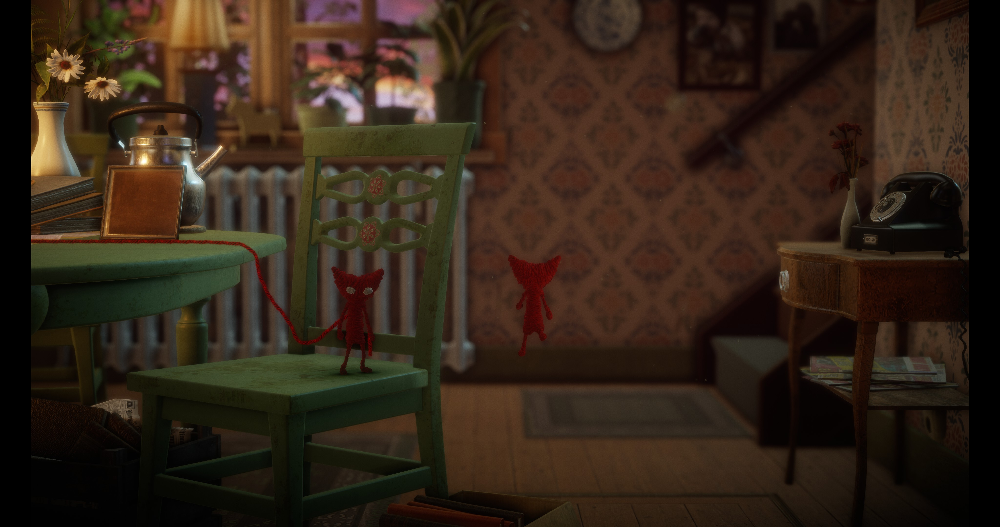
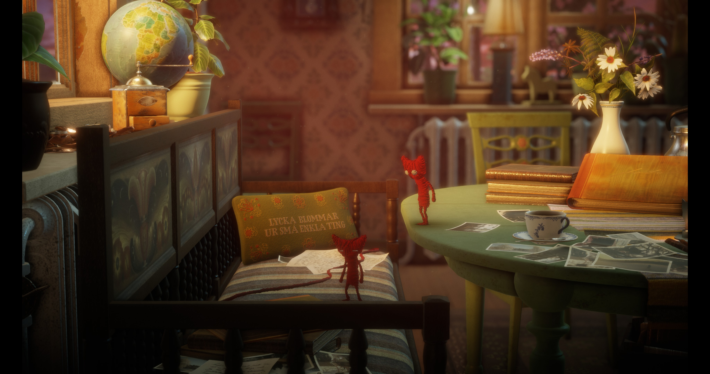
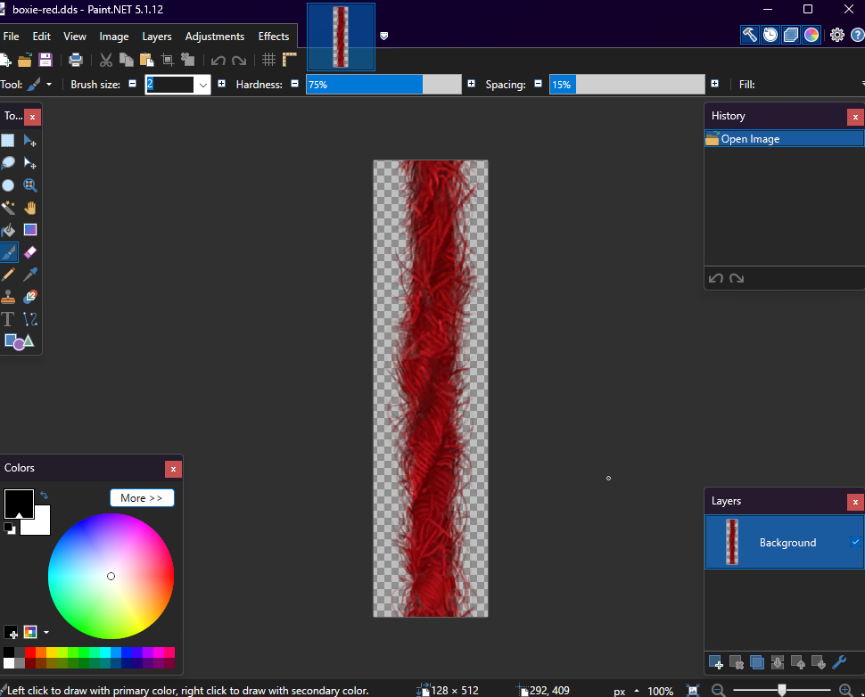
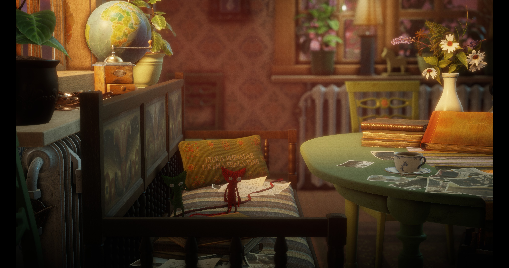
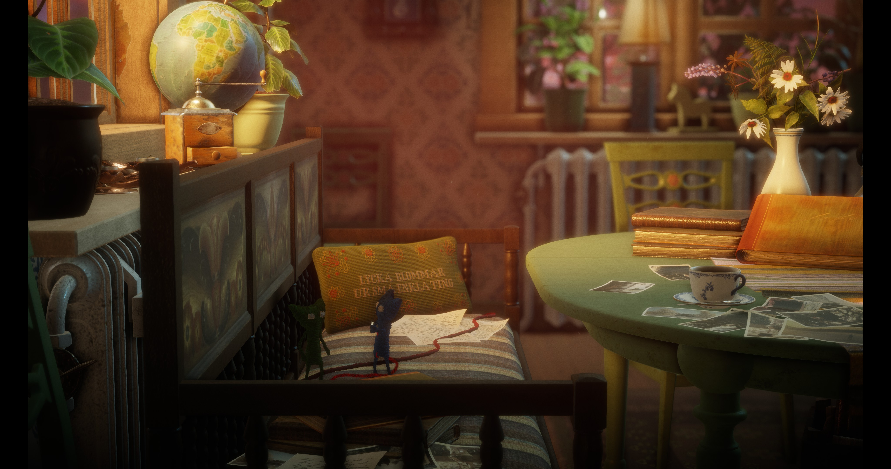
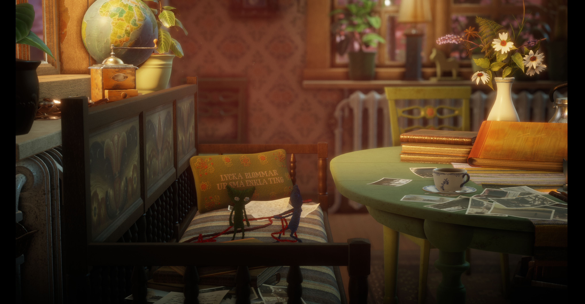
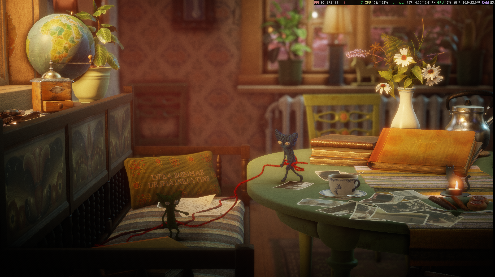

## development stopped

# Better Together
(named after the co-op achievement in *Unravel Two*)
## why?
one day I discovered the soundtrack of the first Unravel when looking for new acoustic/orchestral music on TIDAL. I don't know how exactly I arrived at it,
but the algo served up *The Red Thread* by Frida Johansson and Henrik Oja ([TIDAL](https://tidal.com/track/125088565), [Spotify](https://open.spotify.com/track/19ZKAGRawnY8BrRB6bISr6)). I really liked it, so I heart'd it and continued my discovery session.
later on, at some point when slowly migrating from TIDAL to my personal Jellyfin lib and buying music for it, I came upon *The Red Thread* again
I got the rest of the soundtrack and also the one of Unravel Two, which is, in my opinion, even more emotional. I wanted to appreciate it more, so I bought both games on Steam.
I didn't have anyone to play the second game with, so they both just idled in my lib. however, recently, someone and I played and completed Unravel Two and had so much fun while at it
we didn't get most of the story, but we laughed so hard through it. it was a really great experience. then, after two or three sessions, by the end of it, even without narrative context,
it got pretty emotional for me. the last cutscene and the credits. the credits, especially, because you could see in them that the dev team cared immensely about the game. it was a passion project
driven by actual emotions, loss, love, connection, mutual assistance, instead of what we see most these days, which is greed. EA's stupid launcher and DRM notwithstanding, I have nothing to say against the game
when we got off our call shortly after completing the game, I cried a little bit due to the emotion of it all. it got to me so much such that I decided that I wanted to play the first game with her, too

## how multiplayer if no multiplayer?
the first Unravel doesn't have multiplayer. but I am a software developer, so I stubbornly decided that I would make it work anyway. incidentally, shortly prior, I started my work on [LibreSteam](https://github.com/danglingptr0x0/libresteam), which
helped me get into the game's runtime memory. I tried hooking the Steam API shared lib, but EA's close-minded, anti-consumer, aggressive launcher + the DRM decrypt parts of the init code at runtime, so
I had to do something else. this led me to implement runtime injection in LibreSteam, which I then used to hook the running process once it was already up. I got a REPL inside it and started looking around
the engine is very well made and understandable, and it has a Lua 5.1 runtime inside it, which controls a lot of the playercontroller logic, among many other things

I've since worked nearly non-stop to get multiplayer working well. I am still on it and not ready to share it just yet, but I will, soon. for now, here are some progress screenshots

*first successful spawn, though detached from any playercontroller and floating, turned away*

*here I could control both simultaneously using my single PS5 gamepad*

*I moved her spawn location to my left so that we'd start where the story intended*

*wanting to recover our Unravel Two appearance, I started looking into runtime texture and material patching*

*first tex dumped from live memory and written to a DDS*

*her character is now her exact Unravel Two color*

*both of us are now as we were in Unravel Two in terms of color. her Parsec virtual gamepad input now also gets discovered by the engine and works independently of me*

*got yarn attachment working, though the thread is maximally long, so I will need to fix that next (the connecting thread remains red. I wanted to fix it, but given the finale track of the game and the game's themes
around the color red, I decided to keep it; seems fitting)*

 
If you have anyone whom you care about or just want to have a fun time with online, buy the second game. if you want to try my mod, then buy the first one as well and go through the game together 
<a href="https://store.steampowered.com/app/1225570/">Unravel Two</a> 
<a href="https://store.steampowered.com/app/1225560/">Unravel</a>
 
 
 
 
 
 
 

### devlog
we've tried for the first time to play the first game together using this mod, but she was attached to the sofa via the thread. I must have made a mistake somewhere
then, moments later, it segfaulted at a hand-IK request in her playercontroller. I feel like an idiot a bit since I was at least somewhat confident that it'd work, but oh, well
fixing it now and we'll retry later

as of 2026/11/13, I am not working on this mod anymore. certain circumstances have changed, and I no longer feel like I want to finish it. feel free to pick it up

*crash one, at which point I thought it was because we collided*

*crash two*

 
 
 
 
 
 
 
 
 
 
 
 
 
 

(I started crying like a small child when I listened to the entire soundtrack again while working on this. the fun and emotional experience of the second game, plus the soundtrack in and of itself, were
quite enough for that. but I didn't feel sad. it was more like ... joy? *Bright as Day* ([TIDAL](https://tidal.com/track/105667761), [Spotify](https://open.spotify.com/track/72Tj7rIfjQhYv7BoMoRcsQ)), especially)
